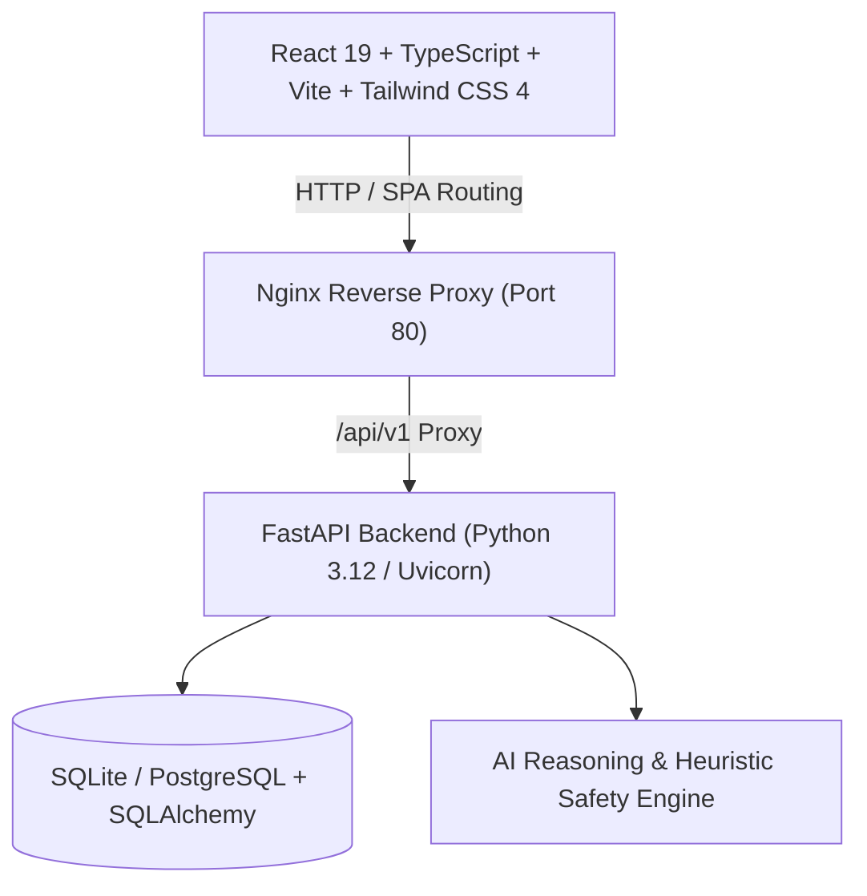

# 🌟 Digital Saathi (डिजिटल साथी)

> **आपकी भाषा, आपकी आवाज़, आपका डिजिटल साथी**  
> *AI-powered Voice & Literacy Assistant for Indian Citizens, Elderly Users, and First-Time Internet Navigators.*

---

## 📖 Overview

**Digital Saathi** is an inclusive, voice-first digital empowerment platform built specifically for Indian citizens who face linguistic, digital, or literacy barriers. Designed with empathy and accessibility at its core, Digital Saathi safeguards citizens against online cyber frauds, translates intimidating bureaucratic and banking forms into plain language, explains official documents, and acts as a conversational voice companion in Hindi and English.

---

## ✨ Key Modules & Capabilities

### 1. 🎙️ Voice Saathi (आवाज़ साथी)
- **Natural Voice Conversations:** Speak in Hindi (`hi-IN`) or English (`en-IN`) using integrated Web Speech API recognition.
- **Auditory Feedback:** Every assistant response features synthesized voice playback with configurable speech rates.
- **Context-Aware Assistance:** Answers day-to-day questions regarding government schemes (PM-KISAN, Ayushman Bharat, PM-AAY), banking services, cyber safety, and digital navigation.

### 2. 🛡️ Scam Saathi (स्कैम साथी)
- **Fraud & Scam Detection:** Analyzes suspicious SMS messages, WhatsApp forwards, loan offers, lottery messages, and emails.
- **Risk Scoring:** Assigns clear risk levels (**HIGH RISK 🚨**, **MODERATE RISK ⚠️**, **SAFE ✅**) with detailed indicators.
- **Red Flag Analysis:** Detects urgency traps, suspicious APK/links, impersonation of banks/government bodies, and OTP requests.
- **Immediate Action Steps:** Clear, non-technical instructions on what to do and who to contact.
- **1930 Cybercrime Helpline:** Integrated banner and quick-dial guidance for the National Cyber Crime Reporting Portal.

### 3. 📋 Form Saathi (फॉर्म साथी)
- **Field-by-Field Clarification:** Explains complex application forms (PAN Card, Aadhaar updates, PM-KISAN, passport, bank KYC).
- **Plain-Language Translations:** Transforms bureaucratic jargon into simple conversational Hindi and English.
- **Document Checklist:** Outlines required supporting documents, eligibility criteria, and step-by-step instructions.

### 4. 📄 Document Saathi (दस्तावेज़ साथी)
- **Document Intelligence:** Secure upload and processing of official letters, notices, utility bills, and bank statements.
- **Simplified Summaries:** Extracts key dates, payment amounts, deadlines, and action items in clear language.
- **Privacy-First:** Secure file storage with metadata tracking and isolated uploads directory.

### 5. ♿ Comprehensive Accessibility Suite
- **Text Scaling:** Instant one-click toggling between Normal (`A`), Large (`A+`), and Extra Large (`A++`).
- **High-Contrast Mode:** High-visibility black & yellow theme for visually impaired users.
- **Dark Mode Support:** Full dark mode support throughout the platform.
- **Screen-Reader & Keyboard Optimized:** Fully accessible ARIA semantics, role definitions, and focus rings.

---

## 🛠️ Architecture & Tech Stack



| Layer | Technologies |
|---|---|
| **Frontend** | React 19, TypeScript, Tailwind CSS 4, Vite, Lucide Icons, React Router 7 |
| **Backend** | FastAPI, Python 3.12, Uvicorn, Pydantic v2, SQLAlchemy 2.0 |
| **Database** | SQLite (development) / PostgreSQL (production / Docker Compose) |
| **Authentication** | JWT Bearer Authentication, Passlib (bcrypt) password hashing |
| **Testing** | Pytest + AsyncIO (backend), Vitest + React Testing Library + JSDOM (frontend) |
| **Containerization** | Docker multi-stage builds, Docker Compose, Nginx Alpine runtime |

---

## 🚀 Quick Start Guide

### Prerequisites
- **Python:** 3.11 or 3.12
- **Node.js:** 20+ or 22+ (npm 10+)
- **Docker & Docker Compose** *(optional, for containerized run)*

---

### Method 1: Local Development

#### 1. Clone the repository
```bash
git clone https://github.com/your-username/DIGITAL_SAATHI.git
cd DIGITAL_SAATHI
```

#### 2. Backend Setup
```bash
# Navigate to project root
cd /path/to/DIGITAL_SAATHI

# Create and activate virtual environment
python3 -m venv backend/venv
source backend/venv/bin/activate

# Install backend dependencies
pip install -r backend/requirements.txt

# Run database migrations and start FastAPI server
python -m uvicorn backend.app.main:app --host 0.0.0.0 --port 8000 --reload
```
*Backend API will be running at:* `http://localhost:8000`  
*Interactive Swagger docs:* `http://localhost:8000/docs`

#### 3. Frontend Setup
```bash
# Open a new terminal and navigate to frontend directory
cd frontend

# Install dependencies
npm install

# Start Vite dev server
npm run dev
```
*Frontend will be running at:* `http://localhost:5173`

---

### Method 2: Docker Compose (Production Setup)

Run the full stack (PostgreSQL + FastAPI Backend + Nginx Frontend) with a single command:

```bash
# Copy and configure environment variables
cp .env.example .env

# Build and start all services
docker compose up --build -d
```

- **Web Application:** `http://localhost`
- **Backend Health Check:** `http://localhost/api/v1/health`
- **Interactive API Docs:** `http://localhost:8000/docs` *(or through backend service port)*

To stop all services:
```bash
docker compose down
```

---

## 🧪 Testing

### Backend Unit & Integration Tests (pytest)
```bash
# Activate virtual environment
source backend/venv/bin/activate

# Run all backend tests
PYTHONPATH=. pytest backend/tests/test_api.py -v
```
**Test Coverage Includes:**
- `/health` endpoint status checks
- User registration, login, and JWT token issuance
- AI Assistant conversational queries (Hindi & English)
- Scam analysis logic (High-risk lottery scams & genuine transactional alerts)
- Form clarification engine
- Document lifecycle (Upload, retrieve, list, delete)

---

### Frontend Unit & Component Tests (Vitest)
```bash
cd frontend

# Run test suite
npm test

# Run tests in watch mode
npm run test:watch
```
**Test Coverage Includes:**
- `AccessibilityContext`: Font scaling, contrast toggle, speech rate persistence
- `AccessibilityControls`: Modal drawer, text resize, language switching
- `VoiceInputButton`: Web Speech API initialization, recording state, fallbacks
- `Navbar`: 1930 Helpline banner, branding, navigation, language toggle
- `Footer`: Helpline info, quick links, emergency portal references
- `HomePage`: Hero section, quick action cards, accessibility links

---

## 🔑 Environment Variables Reference

Copy `.env.example` to `.env` to configure your environment:

| Variable | Description | Default (Dev) |
|---|---|---|
| `DATABASE_URL` | SQLAlchemy connection string | `sqlite:///./digital_saathi.db` |
| `SECRET_KEY` | Secret key for JWT token signing | `digital_saathi_super_secret_jwt_key` |
| `ALGORITHM` | JWT hashing algorithm | `HS256` |
| `ACCESS_TOKEN_EXPIRE_MINUTES` | Session expiration in minutes | `1440` (24 hours) |
| `GEMINI_API_KEY` | Optional Google Gemini API key for enhanced reasoning | `""` (Heuristic engine active) |
| `UPLOAD_DIR` | Directory for uploaded documents | `./backend/uploads` |
| `CORS_ORIGINS` | Permitted CORS frontend origins | `http://localhost:5173,http://localhost:3000` |
| `VITE_API_URL` | Frontend API base URL | `/api/v1` |

---

## 📡 Core API Endpoints

| Method | Endpoint | Description |
|---|---|---|
| `GET` | `/health` | Server and database health check |
| `POST` | `/api/v1/auth/register` | Create a new citizen account |
| `POST` | `/api/v1/auth/token` | Login and obtain JWT access token |
| `GET` | `/api/v1/auth/me` | Fetch authenticated user profile |
| `POST` | `/api/v1/assistant/chat` | Conversational voice/text assistant |
| `POST` | `/api/v1/scam/analyze` | Scan message or SMS for cyber fraud |
| `POST` | `/api/v1/forms/explain` | Get simplified instructions for any form |
| `POST` | `/api/v1/documents/upload` | Upload official notice or document |
| `GET` | `/api/v1/documents/` | List uploaded user documents |
| `DELETE` | `/api/v1/documents/{id}` | Delete stored document |

---

## 🛡️ Safety & Helplines

If you or someone you know has been affected by cyber fraud or financial scams:
- **National Cybercrime Helpline:** Dial `1930` immediately (India)
- **Official Cybercrime Portal:** [https://cybercrime.gov.in](https://cybercrime.gov.in)
- **Emergency Helpline:** Dial `112`

---

## 📄 License
This project is open-source under the MIT License.
